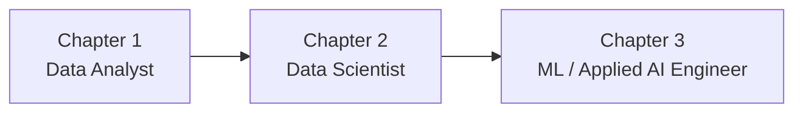

# Hi, I'm Magda 👋

**I turn messy business processes into working AI systems.**

Applied AI Engineer at [deepsense.ai](https://deepsense.ai), based in Warsaw. I started in data analysis, moved into data science, and now build and ship LLM-based applications. This profile is my data story, told in chapters.

## What I do now

- Build LLM applications and agents in Python, from first prototype to production
- Validate LLM outputs, so the answers can be trusted and not just demoed
- Write the backend around the model: APIs, data models, migrations, tests

## The story so far

8+ years across pharma, telecom and AI companies. Each chapter added something I still use every day:

- **Analyst:** understanding the business problem before touching the data
- **Data Scientist:** asking whether the numbers really say what we think they say
- **Engineer:** making it run reliably for real users

## What I bring to a small team

I like working where one person can cover a lot of ground. I can:

- Sit down with the people who have the problem and map how the process really works
- Build the solution end to end: data, API, model, tests
- Document it and train the people who will use it
- Share what I learn, with my team (I recently gave a talk on vibe coding) and in public on Instagram

## Featured chapters

| Repo | What it is |
| --- | --- |
| [my-skill-story](https://github.com/mkostrzewska/my-skill-story) | Reusable AI agent skills that automate my own workflow, starting with pull request review |
| [my-python-story](https://github.com/mkostrzewska/my-python-story) | Python projects from across my career |
| More coming soon | New short projects are on the way |

## Toolbox

**Python:** FastAPI, pydantic, SQLAlchemy, Alembic, pytest, requests  
**AI:** LLM applications, agents (Google ADK), LLM output validation, Model Context Protocol, agent skills  
**Documents and data:** pdfminer, PyPDF2, openpyxl, REST API integrations  
**Cloud:** AWS, Google Cloud

## Always learning

Currently working toward the Anthropic CCAR-F certification.

<b>Certificates (click to expand)</b>

 

**Anthropic**
- Claude 101
- Claude Code 101
- Claude Code in Action
- Introduction to Claude Cowork
- Introduction to Model Context Protocol
- Introduction to Agent Skills

**Google**
- Gemini Enterprise Agents Development (Google Cloud)
- Evaluate and Improve ADK Agents
- Deploy an Agent with ADK
- Accelerate Development with Antigravity

**OpenAI (PartnerU)**
- OpenAI Foundational Knowledge
- Consultative Solutions Practitioner
- Codex Solutions Practitioner

**Other**
- AWS Cloud Practitioner
- Prompt Engineering

## Ask me about

- Moving from data analyst to ML engineer
- Checking whether an LLM's answer is actually right
- Vibe coding, and where it helps or hurts

## Say hi

I'm always happy to chat with early-stage teams :)

- [LinkedIn](https://www.linkedin.com/in/magdalenak1/)
- Instagram: [@my.data.story](https://www.instagram.com/my.data.story), where I show (in Polish) how to do analyses that people actually read, plus posts on ML, AI and careers in data
